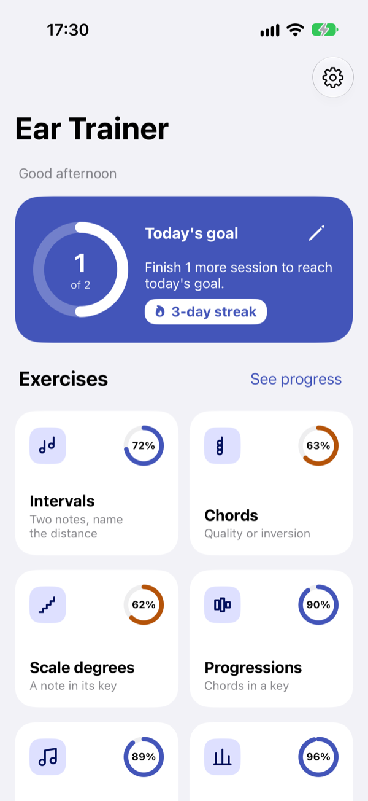
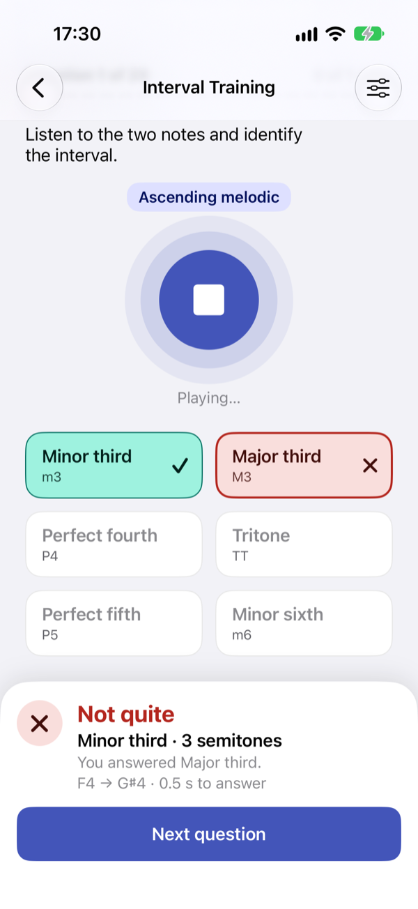
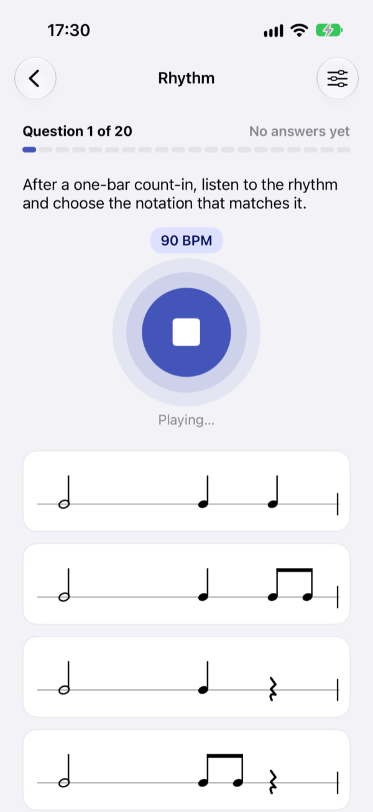
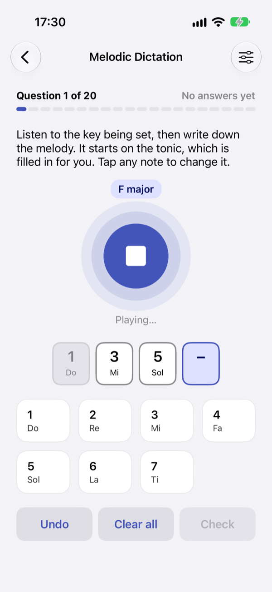
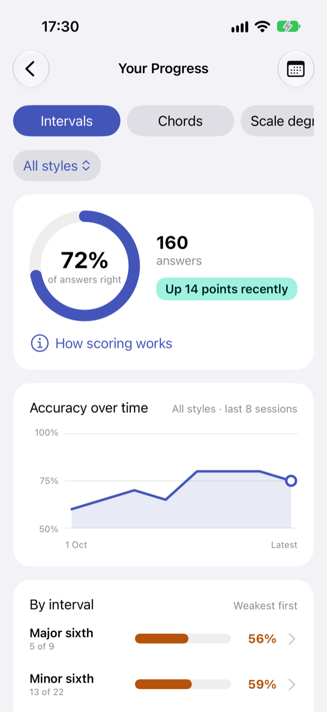
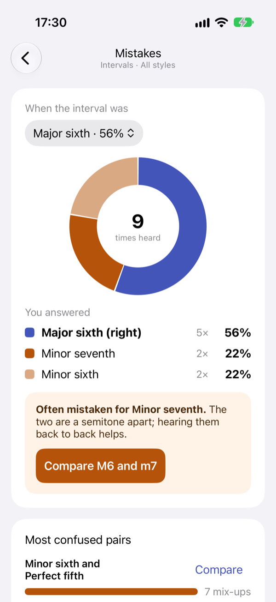
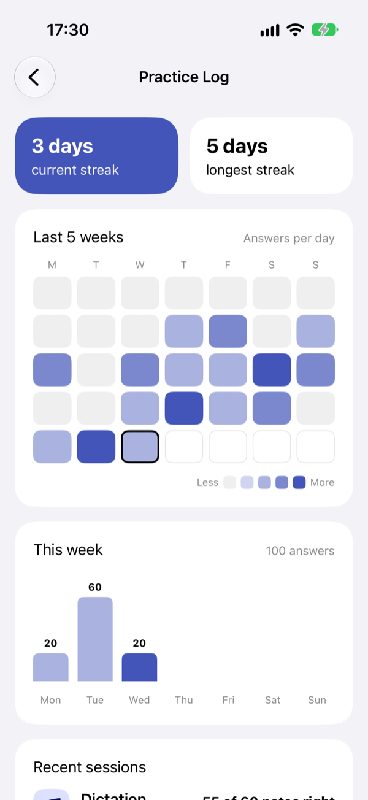
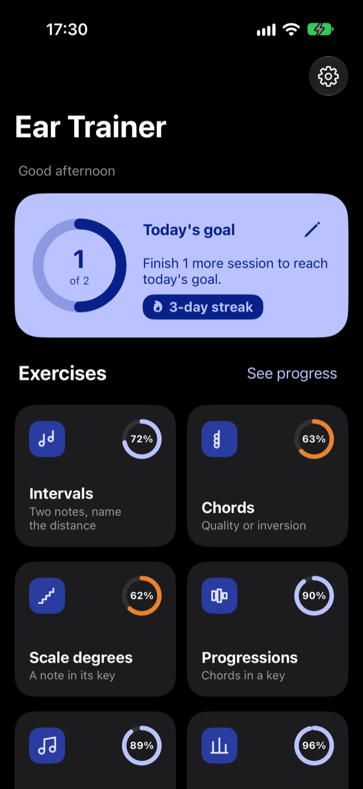

# Ear Trainer

An ear training app for Android and iOS. Six exercises (intervals, chords, scale degrees,
progressions, melodic dictation and rhythm) are played with sampled piano or guitar. Each session
is 20 questions and ends with a summary. Practice concentrates on the items you miss most. The app
also tracks progress and mistakes, with side-by-side comparison drills, and keeps a practice log
and a daily goal.

  
  
  
  

  
  
  
  

Screenshots are from the iOS app. The Android app has the same screens.

| Folder | What it is |
| --- | --- |
| `app/` | The Android app (Kotlin, Jetpack Compose) |
| `ios/` | The iOS app (Swift, UIKit); see [ios/README.md](ios/README.md) |
| `shared/assets/` | Instrument recordings bundled by both apps |

## Building

**Android:** open the project root in Android Studio, or run `./gradlew :app:assembleDebug`.
Unit tests run with `./gradlew test`.

**iOS:** open `ios/EarTrainer.xcodeproj` in Xcode 16 or later and run the `EarTrainer` scheme
(iOS 17+).

## Keeping the two apps in step

The iOS app is a port of the Android one, and they share more than the recordings:

- The music theory, question generators, weak-spot weighting and history queries are written the
  same way in both, so a change to how questions are chosen or scored belongs in both apps.
- Practice history uses the same tables and columns, and settings use the same key names.
- Backups use the same JSON format, so a backup made on one platform restores on the other.
  Changing that format, a setting key or a stored enum name affects both apps.

## Instrument recordings

Both instruments come from the [FreePats](https://freepats.zenvoid.org/) project under CC0. The
README and license for each are next to its recordings in `shared/assets/instruments/`.
